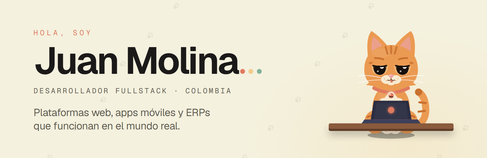
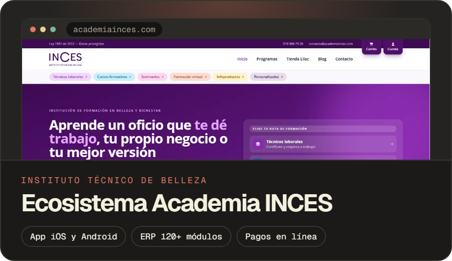
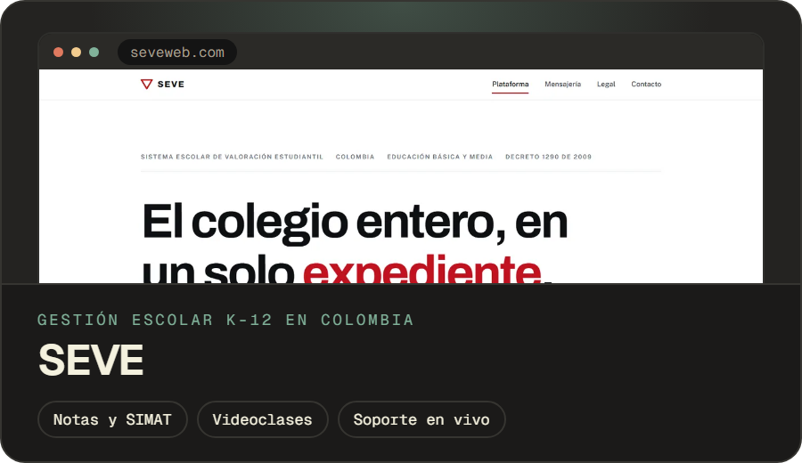
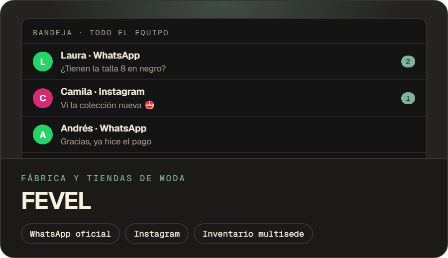
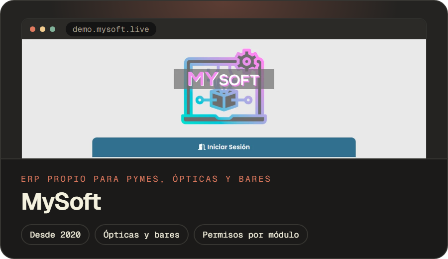
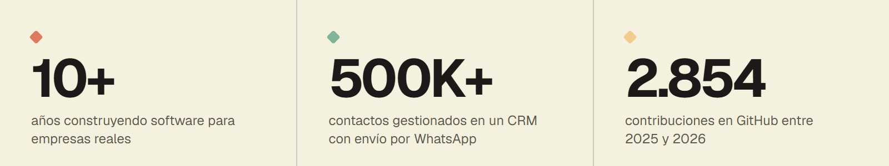
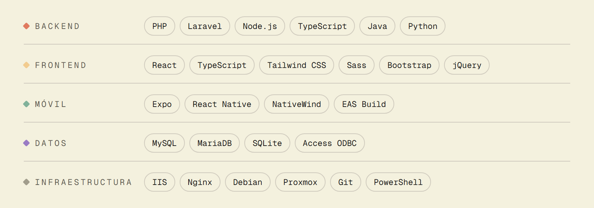

<a href="https://juanmolina.dev">
  <picture>
    <source media="(prefers-color-scheme: dark)" srcset="Imagenes/banner-oscuro.png">
    
  </picture>
</a>

  
  
  

### Hola, soy Juan 👋

Llevo más de 10 años construyendo **software que funciona en el mundo real** para colegios, academias, fábricas, ópticas y tiendas en Colombia: plataformas web, apps móviles para iOS y Android, ERPs a medida e integraciones con WhatsApp, Instagram y pagos en línea.

No entrego un proyecto y desaparezco: entiendo el problema, lo diseño, lo programo, lo despliego y me quedo para mantenerlo y hacerlo crecer.

> La mayor parte de mi código vive en repositorios privados de clientes, por eso aquí se ve poco. Lo que hago está en [juanmolina.dev](https://juanmolina.dev).

 

## Proyectos destacados

<table>
  <tr>
    <td width="50%" valign="top">
      
      Sitio web con matrícula en línea, app iOS y Android, sistema de notas, ERP de más de 120 módulos, tienda y asistencia por QR. Todo conectado.
    </td>
    <td width="50%" valign="top">
      
      Notas, boletines, observador, asistencia y reportes a SIMAT para colegios, con videoclases, soporte en vivo y cartera de tesorería.
    </td>
  </tr>
  <tr>
    <td width="50%" valign="top">
      
      Un ERP de inventario multisede y una bandeja donde todo el equipo de ventas atiende WhatsApp e Instagram.
    </td>
    <td width="50%" valign="top">
      
      Mi propio ERP desde 2020: ventas, inventario, citas e historias clínicas para ópticas, y mesas y cuentas para bares.
    </td>
  </tr>
</table>

**Y en la pared hay más:** [Lilac by INCES](https://lilacbyinces.com) (tienda en línea) · Plataforma de sorteos · Plataforma de eventos · Plataforma de citas · Migraciones desde WordPress para la [I.E. Juan XXIII](https://iedjuanxxiii.edu.co) y las [Hermanas Franciscanas](https://hermanasfranciscanasdelasagradafamilia.com).

 

## En cifras

<picture>
  <source media="(prefers-color-scheme: dark)" srcset="Imagenes/cifras-oscuro.png">
  
</picture>

## Con qué trabajo

PHP y React son mi base. Alrededor, lo que cada proyecto necesite.

<picture>
  <source media="(prefers-color-scheme: dark)" srcset="Imagenes/stack-oscuro.png">
  
</picture>

## Cómo trabajo

`01 Entender` → `02 Diseñar` → `03 Programar` → `04 Desplegar` → `05 Mantener`

Me encargo de todo el ciclo: servidores, backups, monitoreo con reinicio automático y soporte cuando lo necesites.

 

  <b>¿Tienes un proyecto en mente?</b> Cuéntame qué necesitas en <a href="mailto:juan@mysoft.live">juan@mysoft.live</a>. 
  Michi te espera en <a href="https://juanmolina.dev">juanmolina.dev</a> 🐾

